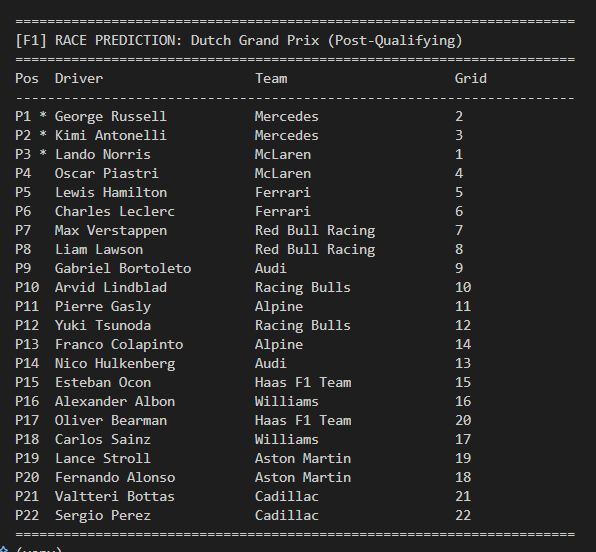
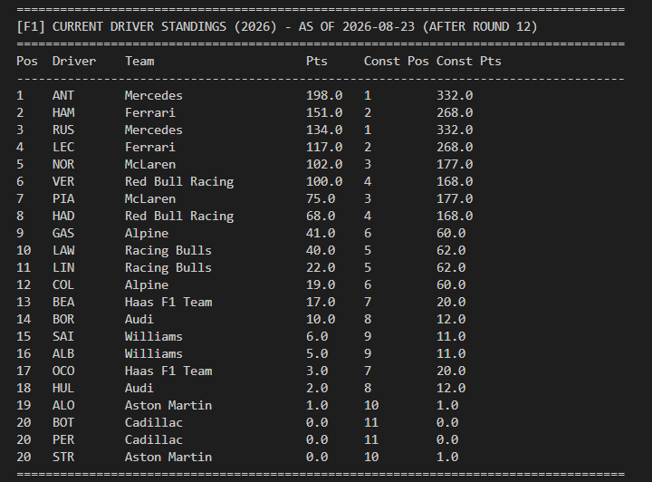

# F1 Race Result Predictor

A Python machine-learning pipeline that predicts Formula 1 race finishing order from qualifying, championship, and historical race data. The project uses FastF1 for live and historical session data and compares Random Forest and XGBoost regressors before saving the best model.

> Predictions are estimates for analysis and experimentation. They do not account for every race-day variable, including strategy, incidents, penalties, weather changes, or driver changes.

## What It Does

- Downloads completed race and qualifying sessions from FastF1.
- Calculates driver and constructor points before each race.
- Builds model features from:
  - Starting grid position
  - Driver championship position and points
  - Constructor championship position and points
  - Driver track history
  - Recent form over the last three races
  - Qualifying gap to pole
- Trains and evaluates Random Forest and XGBoost regression models.
- Rounds predictions to valid finishing positions from 1 to 20.
- Predicts a named race, a race round, or the next upcoming race.
- Shows current driver and constructor standings calculated from completed races.
- Supports pre-qualifying predictions using championship standings and post-qualifying predictions using the actual grid.

## Requirements

- Python 3.10 or newer is recommended.
- Internet access is required when collecting data or requesting live schedules and results.
- FastF1 can download a substantial amount of session data on the first run. Subsequent runs reuse the local cache.

Install the dependencies from [requirements.txt](requirements.txt):

```bash
python -m venv venv
# Windows Git Bash
source venv/Scripts/activate
# macOS/Linux: source venv/bin/activate
python -m pip install --upgrade pip
pip install -r requirements.txt
```

For Windows Command Prompt, activate the environment with `venv\Scripts\activate.bat` instead.

## Quick Start

Run commands from the project root (`f1-race-predictor`). The normal workflow is:

```bash
# 1. Collect completed seasons. The range is inclusive.
# Existing rows are reused; only missing race/qualifying sessions are downloaded.
python -m src.data_collector --start-year 2019 --end-year 2026 --prefix f1_data

# 2. Build model-ready features.
python -m src.feature_engineering --prefix f1_data

# 3. Train, evaluate, and save both models plus the best model.
python -m src.model --prefix f1_data

# 4. Predict the next race. Mode is selected automatically.
python -m src.predictor --next --year auto --data-prefix f1_data --next-mode auto
```

The automatic prediction uses local qualifying data when available. Before
qualifying, it uses the standings-based prediction and does not reload all
previous race sessions.

Use the current calendar year when collecting the latest available data:

```bash
python -m src.data_collector --start-year 2019 --end-year 2026 --prefix f1_data
```

The collector skips future events and only requests sessions for completed race dates.
When rerun with the same prefix, it loads the existing race and qualifying CSV
files and checks each `(Year, Round)` before making a FastF1 session request.
Existing sessions are skipped, newly available sessions are added, and duplicate
rows are removed. FastF1's cache is still used for API responses such as schedules.
Sessions that FastF1 reports as unavailable are recorded in
`f1_data_unavailable_sessions.csv` and skipped on later runs. Use
`--retry-failed` when you want to retry those sessions after data is published.
FastF1 request logs are quiet by default; add `--debug` to the collector or
predictor command when detailed API diagnostics are needed.
Race CSV files contain only race-result fields. Qualifying CSV files retain qualifying times because
the feature pipeline uses them to calculate the gap to pole.
CSV rows are saved in chronological order by season and round, then finishing
or qualifying position.
Training validates required columns, numeric feature values, finishing
positions, duplicate driver/race rows, and unusually incomplete races before
fitting.
Pre-qualifying predictions use the latest completed race to identify the
current driver roster, so replacement drivers from earlier rounds are not
carried into a prediction; the grid is capped at 22 drivers.

## Prediction Commands

`--year` accepts a four-digit year or `auto`, `current`, or `today`. The default model is `best_model`.

```bash
# Predict a specific race by round.
python -m src.predictor --year 2025 --round 10

# Predict a race by its event name. A year may be included in the name.
python -m src.predictor --race "Monaco Grand Prix" --year 2025
python -m src.predictor --race "Monaco Grand Prix 2024"

# Predict the next race with automatic mode selection.
python -m src.predictor --next --year auto --next-mode auto

# Force a pre-qualifying prediction based on championship standings.
python -m src.predictor --next --year auto --next-mode standings

# Force a post-qualifying prediction. Qualifying must be available.
python -m src.predictor --next --year auto --next-mode qualifying

# Predict using the current championship order as an estimated grid.
python -m src.predictor --standings --year 2025

# Predict using a manually supplied grid, ordered from P1 to P20.
python -m src.predictor --grid "VER,NOR,LEC,HAM,PIA,RUS,ALO,SAI,GAS,ALB,OCO,STR,TSU,HUL,BEA,ANT,LAW,BOR,HAD,DOO" --year 2025

# Choose a saved model explicitly.
python -m src.predictor --race "Monaco Grand Prix" --year 2025 --model xgboost
```

`--race` decides automatically: a race that is already in the collected data is compared with its actual result, and an upcoming race is predicted from its qualifying grid. When a compared race was part of the training data, the output says so, because the model has effectively seen that result.

```bash
python -m src.predictor --race "Monaco Grand Prix 2023"
python -m src.predictor --year 2023 --round 6 --compare --data-prefix f1_data
```

## How accurate is it?

On the newest 20% of races (held out from training, 33 races), compared with simply predicting that everyone finishes where they started:

| Per race | Model (Random Forest) | "Finish = grid" baseline |
|---|---|---|
| Mean absolute error (positions) | 3.67 | 3.64 |
| Rank correlation with the result (Spearman) | 0.63 | 0.62 |
| Winner predicted correctly | 58% | 67% |
| Podium drivers predicted (share of 3) | 62% | 68% |

So the model currently performs **about as well as the starting grid**, which is a strong baseline in F1. Treat predictions as an estimate, not a forecast with an edge.

## Current Standings

Standings are calculated from completed race results up to the date the command runs. They are not read from a separate official championship standings endpoint.

```bash
python -m src.predictor --current-standings --year 2026
```

The output includes driver position, driver points, constructor position, and constructor points. If no completed races are available for the selected year, the command reports that standings are unavailable.

## Models And Evaluation

The training command:

1. Loads `<prefix>_features.csv`.
2. Splits the data into training and test sets using a fixed random state.
3. Trains Random Forest and XGBoost regressors.
4. Reports MAE, RMSE, R2, and the percentage of predictions within three positions.
5. Runs five-fold cross-validation.
6. Prints XGBoost feature importance.
7. Saves the model with the lower test MAE as `best_model`.

Predictions are rounded to the nearest integer and clipped to positions 1 through 20. The model output is a predicted order, not a probability or a guaranteed race result.

## Generated Files

The default prefix is `f1_data`. Custom prefixes can be supplied with `--prefix` and `--data-prefix`.

| Path | Description |
| --- | --- |
| `data/f1_data_races.csv` | Completed race results and metadata |
| `data/f1_data_qualifying.csv` | Qualifying positions and session times |
| `data/f1_data_standings.csv` | Driver and constructor points before each race |
| `data/f1_data_features.csv` | Filled, model-ready training features |
| `data/cache/fastf1/` | FastF1 local cache |
| `models/random_forest.joblib` | Trained Random Forest model |
| `models/xgboost.joblib` | Trained XGBoost model |
| `models/best_model.joblib` | Model selected by test MAE |

The command-line predictor prints tables to the terminal; it does not currently write prediction or standings tables to CSV automatically.

## Project Structure

```text
f1-race-predictor/
├── data/                    # Downloaded data, features, and FastF1 cache
├── models/                  # Serialized trained models
├── notebooks/               # Exploratory notebooks
├── src/
│   ├── config.py            # Paths, seasons, and model settings
│   ├── data_collector.py    # FastF1 collection and standings calculation
│   ├── feature_engineering.py
│   ├── model.py             # Training, evaluation, and serialization
│   └── predictor.py         # Race predictions and CLI
├── tests/                   # Tests on synthetic data (no FastF1 download): pytest
├── requirements.txt
└── README.md
```

## Results

Add screenshots of the terminal output below. Store the image files in `docs/screenshots/` and keep the filenames stable so the README remains easy to update.

### Race Prediction




Example command:

```bash
python -m src.predictor --next --year auto --next-mode auto
```

### Current Standings





Example command:

```bash
python -m src.predictor --current-standings --year auto
```

## Troubleshooting

- **`ModuleNotFoundError`**: activate the virtual environment and run `pip install -r requirements.txt` again.
- **No race or standings data**: check the year, internet connection, and FastF1 cache logs. Future races are intentionally excluded.
- **Model not found**: run data collection, feature engineering, and model training before prediction, or check the selected `--model` name.
- **Qualifying is unavailable**: use `--next-mode standings` for a pre-qualifying estimate.
- **Ambiguous race name**: include the full event name or a year, for example `--race "Monaco Grand Prix 2024"`.

## License

MIT
